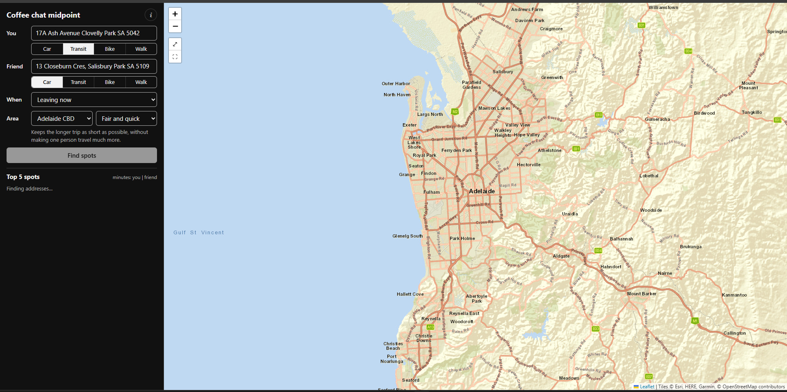

# Coffee chat midpoint

Find a café in Adelaide that's fair for both you and a friend, ranked by both people's real travel times.

**Try it:** https://pisethtang.github.io/meetup-chat/



## Features

- **Each person picks how they travel:** car, public transport, bike or walk.
- **Three ways to rank spots:** fair and quick, same travel time, or least total travel.
- **Real bus, train and tram trips** from Adelaide Metro timetables, preferring less walking.
- **Leave now or meet at a set time.** With a meeting time, it shows when each of you should leave.
- **Driving help:** peak-hour traffic and free-parking hints.
- **Map with both routes,** plus Google Maps directions for each person.

## Run locally

Needs [Bun](https://bun.sh) (1.3+).

```sh
bun install
bun run build    # builds dist/coffee-midpoint.js
```

Then open `coffee-midpoint.html` in a browser. Use `bun run watch` to rebuild on save, and `bun run typecheck` to check types.

## Data sources

| What | Source |
|---|---|
| Addresses | OpenStreetMap ([Nominatim](https://nominatim.org), [Photon](https://photon.komoot.io)) |
| Road times and routes | [OSRM](https://project-osrm.org) |
| Public transport | [Transitous](https://transitous.org) (Adelaide Metro timetables) |
| Cafés and car parks | OpenStreetMap ([Overpass](https://overpass-api.de)), with a built-in fallback list |
| Map | [Leaflet](https://leafletjs.com) with Esri World Street Map tiles |

All free public services, so please keep usage light.

## Project layout

```
coffee-midpoint.html   page markup
coffee-midpoint.css    styles
src/main.ts            ranking, map and results
src/transit.ts         public transport trips
src/geocode.ts         address lookup
src/data.ts            suburbs, café strips, cafés and areas
```

Every push to `main` deploys to GitHub Pages ([deploy.yml](.github/workflows/deploy.yml)).

## License

[MIT](LICENSE). Map data © OpenStreetMap contributors (ODbL).
